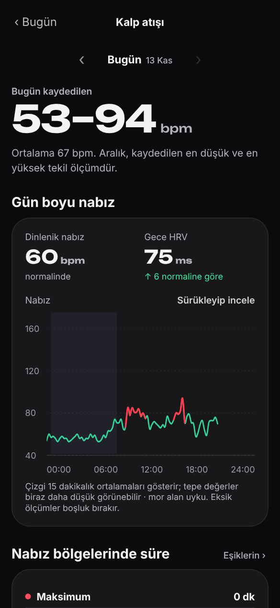
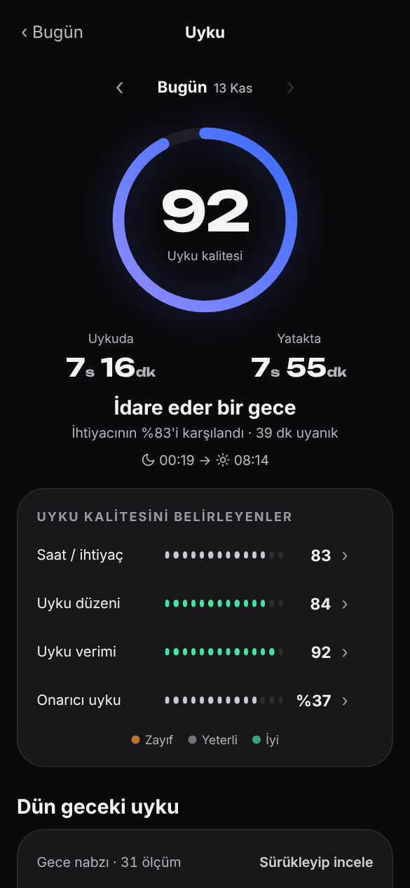
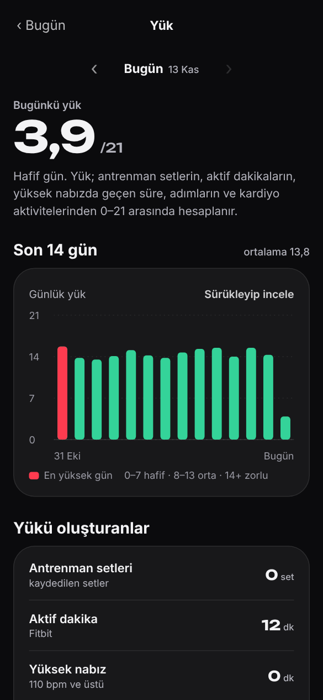

# HypeMode

**Kişisel fitness koçu: antrenman, beslenme, uyku ve toparlanma tek uygulamada.**

[**▶ Uygulamayı aç**](https://yasindogruu.github.io/HypeMode/) · iPhone · iPad · Bilgisayar

  
  
  
  
  
  

## Özellikler

**🏋️ Antrenman**
- Şablonlar, süperset ve set türleri (ısınma, drop set, failure)
- Kilo ve tekrar önerisi veren ilerleme sistemi
- **Hızlı antrenman:** Hareketi ara, hedef koy (ör. 100 şınav), başlat ya da direkt kaydet
- **Ev / salon modu:** Evdeysen şablondaki hareketler eldeki ekipmana göre otomatik değişir
- **Otomatik ısınma setleri:** Çalışma kilona göre ısınma setlerini hesaplar
- **Egzersiz Akademisi:** 400'den fazla hareket; adım adım anlatım, sık hatalar, önerilen set/tekrar, video ve tıklanabilir vücut haritası
- Evde antrenman oluşturucu (ekipman ve bölge seçimi)
- Form ipuçları, kas haritası, kardiyo yükü

**🍽️ Beslenme**
- Günlük kalori ve makro takibi, su ve içecekler
- Fotoğraftan kalori tahmini ve "Ne pişirsem?" (claude.ai sürümünde, Claude ile)
- Uyarlanabilir kalori hedefi, sık yenenler, takviyeler
- Hedefler: definasyon, koruma ve kas kazanımı (bulk). Bulk hızı araştırmalara göre ayarlanır: haftada vücut ağırlığının %0,25–0,5'i, ileri seviyede %0,15 (Iraki ve ark. 2019; Helms ve ark. 2023)

**🧮 Araçlar**
- Kalori & makro, BKİ & ideal kilo, yağ oranı & bel-kalça oranı, 1RM, plaka hesaplayıcı, su ihtiyacı, kalp hızı bölgeleri

**📊 Bugün ekranı ve detay sayfaları**
- Günün hazırlık halkası ve Uyku, Yük, Kalp, Adım kartları
- Ana ekranda Kalp atışı, Adım, Uyku ve Yük kutuları; dokununca ayrıntılı sayfa açılır
- **Kalp atışı:** dakika dakika nabız grafiği (Google Health ile aynı tepe değerleri), nabız bölgeleri, toparlanma sinyalleri, 7 günlük dinlenik nabız ve HRV eğilimi
- **Uyku:** uyku kalitesi puanı ve onu belirleyenler, evreler, evre zaman çizelgesi, uyku ihtiyacı, uyku düzeni ve şekerlemeler
- **Yük:** 0–21 günlük yük, son 14 gün ve yükü oluşturanlar
- Grafikler parmakla sürüklenerek incelenir; tepe noktaları kırmızıyla işaretlenir

**😴 Toparlanma**
- Enerji bankası, uyku koçu, akıllı uyandırma, biyolojik yaş
- Sağlık ve stres monitörü, regl döngüsü takibi

**⌚ Google Fitbit desteği**
- Google Fitbit (Fitbit Air) ve Google Health verileriyle çalışır: uyku evreleri, HRV, dinlenik nabız, kan oksijeni, solunum hızı, adım ve aktif dakika
- Toparlanma, uyku ve yük halkaları, enerji bankası ve uyku koçu bu verilerle kişiselleşir
- **Ayarlar → Google Health · Fitbit** bölümünden Google hesabınla doğrudan bağlanır (sadece okuma); bağlı cihazlar ve pil durumu görünür
- Saat bağlı değilken uyku ve kiloyu elle girerek ya da örnek veriyle de kullanılabilir

**👥 Arkadaşlar**
- Kullanıcı adıyla arkadaş ekleme ve arkadaşlık istekleri
- Arkadaşının son antrenmanını görme, beğenme ve yorum yapma
- Tek dokunuşla hatırlatma gönderme: Antrenman, Su iç, Yemek ye; uygulama kapalıyken de bildirim gelir
- Rahatsız eden kişiyi **engelleme** ve **şikâyet etme**
- Arkadaşının programını kopyalama
- Ortak antrenman: arkadaşın antrenmana başlayınca bildirim gelir; canlı ilerlemesini görüp "Birlikte yap" ile aynı antrenmanı başlatabilir, tezahürat gönderebilirsin

**📱 Her cihazda**
- Ana ekrana eklenince uygulama gibi tam ekran açılır, çevrimdışı da açılır
- Tek hesapla telefon, iPad ve bilgisayarda aynı veriler
- Geniş ekranda üst menülü masaüstü düzeni
- Koyu, açık ve sistem teması; Enerji, Okyanus, Lavanta ve Gece dahil 11 renk teması
- Parçacık efektli açılış animasyonu
- Ana ekran ve antrenman sayfası düzenlenebilir (istemediğin bölümleri gizle)
- Türkçe ve İngilizce (TR | EN seçici)
- Erişilebilirlik: okunur kontrast, en az 44 px dokunma alanları, klavye odağı, hareket azaltma desteği
- Hesabı ve tüm verileri silme, verileri indirme

## Kurulum (kullanıcı)

1. Telefonda **Safari** ile [yasindogruu.github.io/HypeMode](https://yasindogruu.github.io/HypeMode/) adresini aç.
2. **Paylaş (□↑) → Ana Ekrana Ekle**'ye bas.
3. Simgeden aç; e-posta ya da Google ile hesap oluştur veya hesap açmadan devam et.
4. Bildirim için **Ayarlar → Hesap → Kapalıyken bildirimleri aç**'a bas.

## Gizlilik ve güvenlik

- **Yasal metinler:** [Aydınlatma Metni](https://yasindogruu.github.io/HypeMode/gizlilik.html) · [Açık Rıza Metni](https://yasindogruu.github.io/HypeMode/acik-riza.html) · [Kullanım Koşulları](https://yasindogruu.github.io/HypeMode/kullanim-kosullari.html) · [Çerez ve Yerel Depolama](https://yasindogruu.github.io/HypeMode/cerez.html)
- **Açık rıza:** Verilerin yurt dışındaki sunuculara (Google Firebase, ABD) aktarılması ve sağlık verilerinin buluta yedeklenmesi için ayrı ayrı onay istenir. Sağlık verisine onay vermezsen bu veriler yalnızca cihazında kalır. Onaylarını Ayarlar → Gizlilik ve yasal bölümünden istediğin an değiştirebilirsin.
- **Hesapsız kullanım:** İstersen hesap açmadan, veriler yalnızca cihazında kalacak şekilde kullanabilirsin.
- **Takip yok:** Reklam, analitik, oturum kaydı ya da takip aracı kullanılmaz. Yazı tipleri ve Firebase kütüphanesi de kendi sunucumuzdan yüklenir.

- **Kendi verilerin** (antrenman, beslenme, kilo, sağlık, döngü) sadece senin hesabında tutulur. Veritabanı kuralları başka hiçbir kullanıcının okumasına izin vermez.
- **Arkadaş profili** (ad, kullanıcı adı, son antrenman özeti) sadece karşılıklı arkadaş olduğun kişilere açıktır. Bu kural sunucuda uygulanır; başkaları göremez.
- **Arkadaştan gelen her veri** (ad, yorum, fotoğraf) ekrana basılmadan önce temizlenir; bu alanlara gizlenmiş kod çalışmaz.
- **Giriş:** Şifreler Firebase'de geri çözülemeyecek şekilde (hash) saklanır. Google ile girişte şifren uygulamaya hiç gelmez.
- **Bağlantı:** Tüm bağlantılar HTTPS ile şifrelidir; veriler Google sunucularında şifreli olarak saklanır.
- Sağlık tahminleri bilgilendirme amaçlıdır, tıbbi tavsiye değildir.
- İletişim ve KVKK başvuruları: ysndogru54@gmail.com

## Lisans

© 2026 Yasin Doğru. Tüm hakları saklıdır. Bu depodaki kod, tasarım ve görseller izin alınmadan kopyalanamaz, değiştirilemez, dağıtılamaz veya başka bir uygulamada kullanılamaz. Ayrıntılar: [LICENSE](LICENSE)
