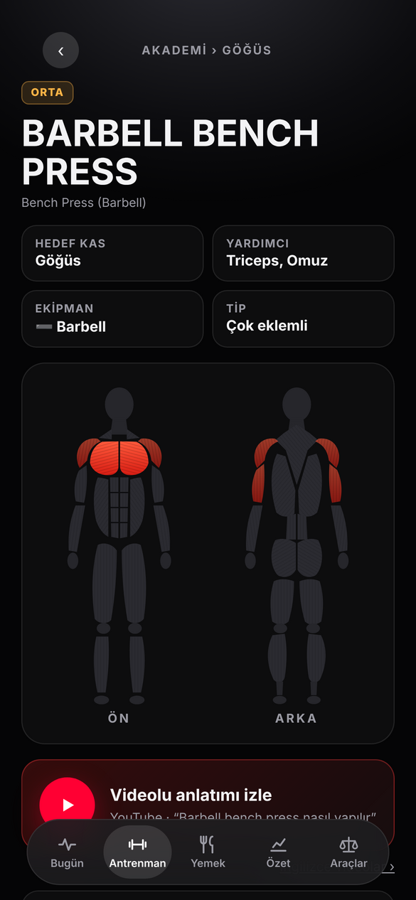
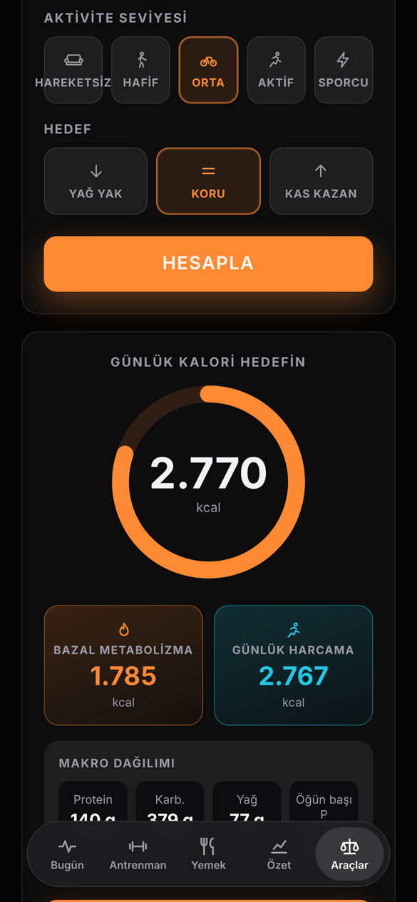

# HypeMode

**Kişisel fitness koçu: antrenman, beslenme, uyku ve toparlanma tek uygulamada.**

[**▶ Uygulamayı aç**](https://yasindogruu.github.io/HypeMode/) · iPhone · iPad · Bilgisayar

  
  
  
  
  

## Özellikler

**🏋️ Antrenman**
- Şablonlar, süperset ve set türleri (ısınma, drop set, failure)
- Kilo ve tekrar önerisi veren ilerleme sistemi
- **Hızlı antrenman:** Hareketi ara, hedef koy (ör. 100 şınav), başlat ya da direkt kaydet
- **Ev / salon modu:** Evdeysen şablondaki hareketler eldeki ekipmana göre otomatik değişir
- **Otomatik ısınma setleri:** Çalışma kilona göre ısınma setlerini hesaplar
- **Egzersiz Akademisi:** 400'den fazla hareket; adım adım anlatım, sık hatalar, önerilen set/tekrar, video ve tıklanabilir vücut haritası
- Evde antrenman oluşturucu (ekipman ve bölge seçimi)
- Form ipuçları, kas haritası, kardiyo yükü

**🍽️ Beslenme**
- Günlük kalori ve makro takibi, su ve içecekler
- Fotoğraftan kalori tahmini ve "Ne pişirsem?" (Claude ile)
- Uyarlanabilir kalori hedefi, sık yenenler, takviyeler
- Hedefler: definasyon, koruma ve kas kazanımı (bulk). Bulk hızı araştırmalara göre ayarlanır: haftada vücut ağırlığının %0,25–0,5'i, ileri seviyede %0,15 (Iraki ve ark. 2019; Helms ve ark. 2023)

**🧮 Araçlar**
- Kalori & makro, BKİ & ideal kilo, yağ oranı & bel-kalça oranı, 1RM, plaka hesaplayıcı, su ihtiyacı, kalp hızı bölgeleri

**😴 Toparlanma**
- Uyku, toparlanma ve yük halkaları
- Enerji bankası, uyku koçu, biyolojik yaş
- Sağlık ve stres monitörü, regl döngüsü takibi

**⌚ Google Fitbit desteği**
- Google Fitbit (Fitbit Air) ve Google Health verileriyle çalışır: uyku evreleri, HRV, dinlenik nabız, kan oksijeni, solunum hızı, adım ve aktif dakika
- Toparlanma, uyku ve yük halkaları, enerji bankası ve uyku koçu bu verilerle kişiselleşir
- Veriler Google Health'ten dışa aktarılıp **Ayarlar → Fitbit Air / Google Health** bölümünden yüklenir
- Saat bağlı değilken uyku ve kiloyu elle girerek ya da örnek veriyle de kullanılabilir

**👥 Arkadaşlar**
- Kullanıcı adıyla arkadaş ekleme ve arkadaşlık istekleri
- Arkadaşının son antrenmanını görme, beğenme ve yorum yapma
- Dürtme ("Hadi antrenmana!", "Su iç!"); uygulama kapalıyken de bildirim gelir
- Arkadaşının programını kopyalama
- Ortak antrenman: arkadaşın antrenmana başlayınca bildirim gelir; canlı ilerlemesini görüp "Birlikte yap" ile aynı antrenmanı başlatabilir, tezahürat gönderebilirsin

**📱 Her cihazda**
- Ana ekrana eklenince uygulama gibi tam ekran açılır, çevrimdışı da açılır
- Tek hesapla telefon, iPad ve bilgisayarda aynı veriler
- Geniş ekranda üst menülü masaüstü düzeni
- Koyu, açık ve sistem teması; Gece teması dahil 8 ana renk
- Ana ekran ve antrenman sayfası düzenlenebilir (istemediğin bölümleri gizle)
- Türkçe ve İngilizce
- Hesabı ve tüm verileri silme, verileri indirme

## Kurulum (kullanıcı)

1. Telefonda **Safari** ile [yasindogruu.github.io/HypeMode](https://yasindogruu.github.io/HypeMode/) adresini aç.
2. **Paylaş (□↑) → Ana Ekrana Ekle**'ye bas.
3. Simgeden aç ve e-posta ya da Google ile hesap oluştur.
4. Bildirim için **Ayarlar → Hesap → Kapalıyken bildirimleri aç**'a bas.

## Gizlilik ve güvenlik

- **Kendi verilerin** (antrenman, beslenme, kilo, sağlık, döngü) sadece senin hesabında tutulur. Veritabanı kuralları başka hiçbir kullanıcının okumasına izin vermez.
- **Arkadaş profili** (ad, kullanıcı adı, son antrenman özeti) sadece karşılıklı arkadaş olduğun kişilere açıktır. Bu kural sunucuda uygulanır; başkaları göremez.
- **Arkadaştan gelen her veri** (ad, yorum, fotoğraf) ekrana basılmadan önce temizlenir; bu alanlara gizlenmiş kod çalışmaz.
- **Giriş:** Şifreler Firebase'de geri çözülemeyecek şekilde (hash) saklanır. Google ile girişte şifren uygulamaya hiç gelmez.
- **Bağlantı:** Tüm bağlantılar HTTPS ile şifrelidir; veriler Google sunucularında şifreli olarak saklanır.
- Sağlık tahminleri bilgilendirme amaçlıdır, tıbbi tavsiye değildir.

## Lisans

© 2026 Yasin Doğru. Tüm hakları saklıdır. Bu depodaki kod, tasarım ve görseller izin alınmadan kopyalanamaz, değiştirilemez, dağıtılamaz veya başka bir uygulamada kullanılamaz. Ayrıntılar: [LICENSE](LICENSE)
