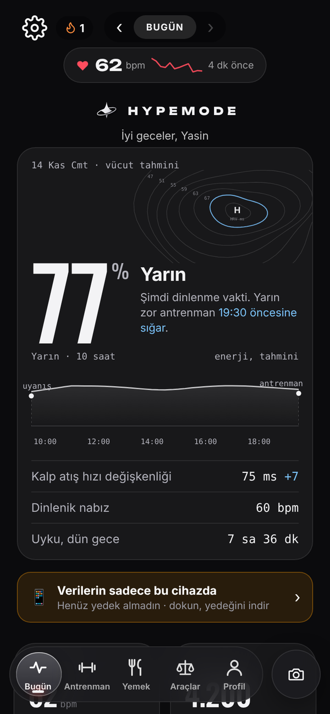
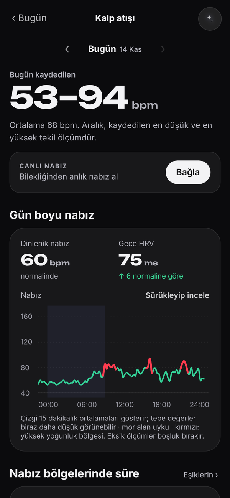
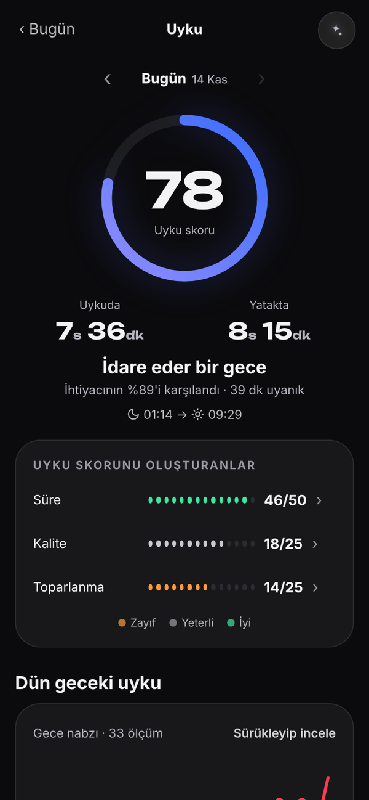
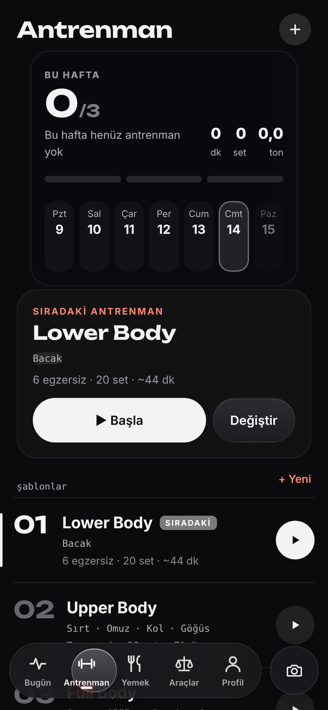
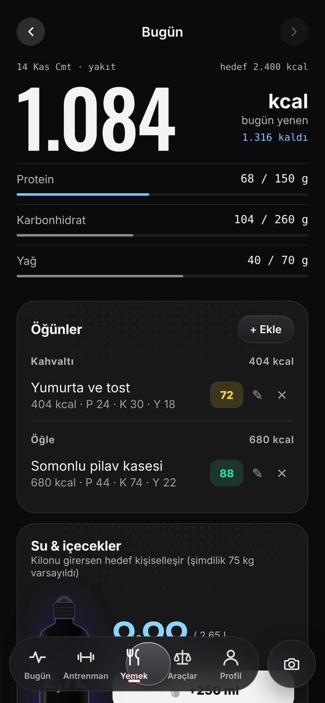

<div align="center">


# HypeMode

**A personal fitness coach: training, nutrition, sleep and recovery in one app.**

[**▶ Open the app**](https://yasindogruu.github.io/HypeMode/) · iPhone · iPad · Desktop · Turkish & English

</div>

<p align="center">
  
  
  
  
  
</p>

<p align="center"><a href="docs/screenshots/README.md"><b>All screenshots →</b></a></p>

## Features

- **Training** – templates, supersets, warm-up/drop sets, progression suggestions, home/gym mode, 400+ exercise library with a body map.
- **Nutrition** – calories, macros, water and drinks, photo-based calorie estimate, adaptive targets for cut / maintain / bulk.
- **Today** – body forecast with a 10-hour energy curve, plus heart rate, steps, sleep and strain detail pages.
- **Recovery** – sleep coach, smart wake, muscle recovery, cycle tracking.
- **Wearables** – Fitbit via Google Health on the web; Apple Health and live Bluetooth heart rate in the iOS app.
- **Friends** – photo stories, comments, challenges, weekly ranking, reminders and live workouts together.
- **Tools** – calorie & macro, BMI, body fat, 1RM, plate calculator, water needs, heart-rate zones.
- **Everywhere** – installable PWA, works offline, syncs across devices, dark/light themes, accessible (44 pt targets, reduced motion).

## Get started

1. Open [yasindogruu.github.io/HypeMode](https://yasindogruu.github.io/HypeMode/) in Safari.
2. Tap **Share → Add to Home Screen**.
3. Sign in with email or Google, or continue without an account.

The native iOS app (Apple Health, live heart rate, widgets) is in [ios/](ios/README.md).

## Privacy

No ads, analytics or trackers. Your data is visible only to you; friends see only what you share. Health data is synced to the cloud only with your consent, and you can use the app fully offline without an account.
Legal texts (Turkish): [Privacy notice](https://yasindogruu.github.io/HypeMode/legal/gizlilik.html) · [Terms](https://yasindogruu.github.io/HypeMode/legal/kullanim-kosullari.html) · Contact: ysndogru54@gmail.com

Health estimates are for information only and are not medical advice.

## Repository

```
src/                     Source code, split by feature
  js/core.js               State, storage, helpers
  js/app.js                Main screens (Today, Workout, Food, Profile)
  js/health/               Google Health (Fitbit), iOS bridge, health views, cycle, conditions, lab results
  js/nutrition/            Adaptive calories, meal programs, weekly meal plan
  js/workout/              Set types, exercise academy, 12-week program generator
  js/social/               Friends, feed, stories, challenges
  css/                     Base styles, layout, desktop, themes
  i18n/en.json             English translations
  manifest.json            File order for the build
tools/build.py           Joins src/ into one file (the deployed index.html)
tools/split.py           Splits a single-file build back into src/
index.html, sw.js        Built web app and service worker (served by GitHub Pages)
assets/  js/  legal/     Fonts and icons, libraries, legal texts
firebase/                Database security rules
ios/                     iOS app (Swift · HealthKit · Bluetooth · WidgetKit)
docs/screenshots/        Screenshots
```

Build: `python3 tools/build.py src build/index.html`

## License

© 2026 Yasin Doğru. All rights reserved. See [LICENSE](LICENSE).
