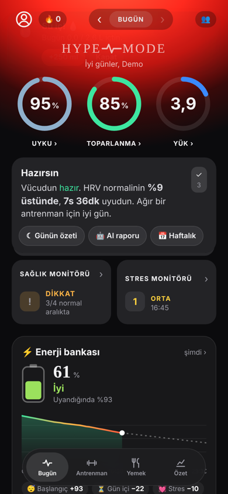
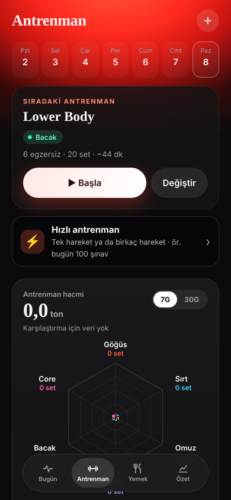
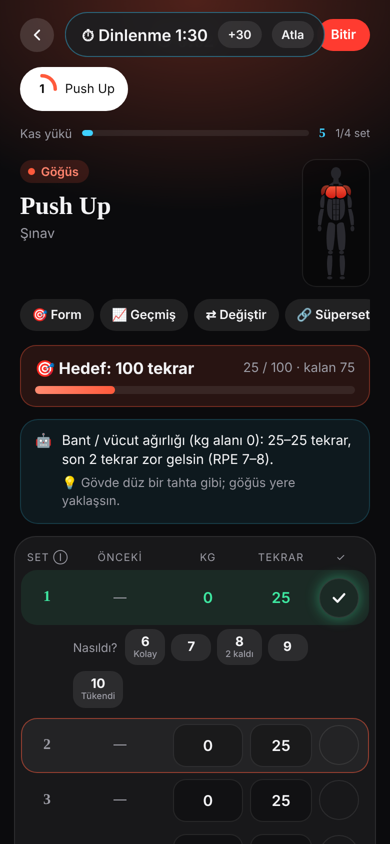
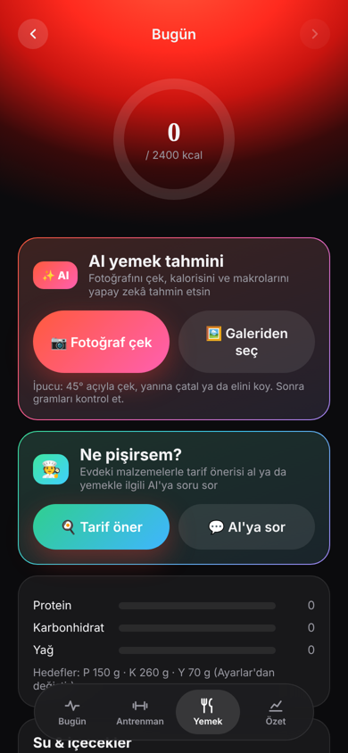
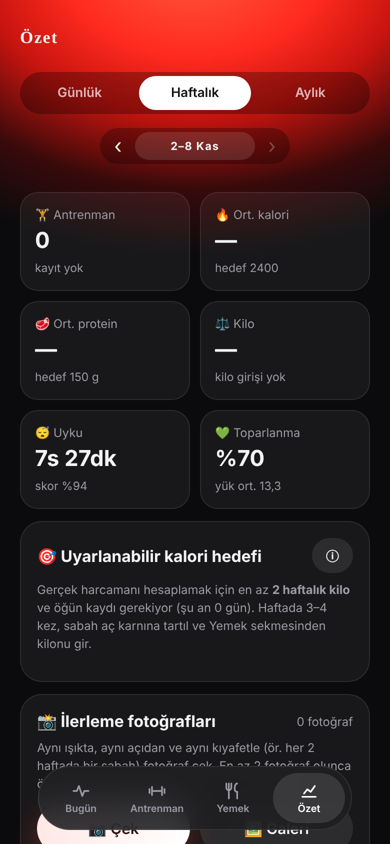
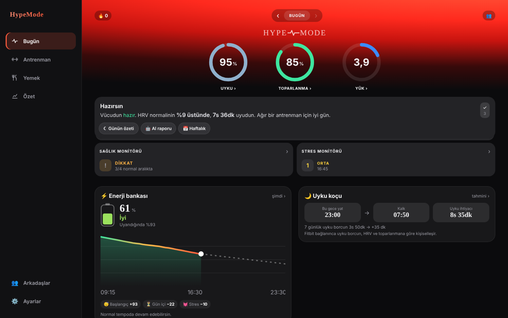

<div align="center">


# HypeMode

**Kişisel fitness koçu: antrenman, beslenme, uyku ve toparlanma tek uygulamada.**

[**▶ Uygulamayı aç**](https://yasindogruu.github.io/HypeMode/) · iPhone · iPad · Bilgisayar

</div>

<p align="center">
  
  
  
  
  
</p>

## Özellikler

**🏋️ Antrenman**
- Şablonlar, süperset ve set türleri (ısınma, drop set, failure)
- Kilo ve tekrar önerisi veren ilerleme sistemi
- **Hızlı antrenman:** Hareketi ara, hedef koy (ör. 100 şınav), başlat ya da direkt kaydet
- **Ev / salon modu:** Evdeysen şablondaki hareketler eldeki ekipmana göre otomatik değişir
- **Otomatik ısınma setleri:** Çalışma kilona göre ısınma setlerini hesaplar
- 400'den fazla hareket ve evde antrenman oluşturucu (ekipman ve bölge seçimi)
- Form ipuçları, kas haritası, kardiyo yükü

**🍽️ Beslenme**
- Günlük kalori ve makro takibi, su ve içecekler
- Fotoğraftan kalori tahmini ve "Ne pişirsem?" (Claude ile)
- Uyarlanabilir kalori hedefi, sık yenenler, takviyeler

**😴 Toparlanma**
- Uyku, toparlanma ve yük halkaları
- Enerji bankası, uyku koçu, biyolojik yaş
- Sağlık ve stres monitörü, regl döngüsü takibi

**⌚ Google Fitbit desteği**
- Google Fitbit (Fitbit Air) ve Google Health verileriyle çalışır: uyku evreleri, HRV, dinlenik nabız, kan oksijeni, solunum hızı, adım ve aktif dakika
- Toparlanma, uyku ve yük halkaları, enerji bankası ve uyku koçu bu verilerle kişiselleşir
- Veriler Google Health'ten dışa aktarılıp **Ayarlar → Fitbit Air / Google Health** bölümünden yüklenir
- Saat bağlı değilken uyku ve kiloyu elle girerek ya da örnek veriyle de kullanılabilir

**👥 Arkadaşlar**
- Kullanıcı adıyla arkadaş ekleme ve arkadaşlık istekleri
- Arkadaşının son antrenmanını görme, beğenme ve yorum yapma
- Dürtme ("Hadi antrenmana!", "Su iç!"); uygulama kapalıyken de bildirim gelir
- Arkadaşının programını kopyalama

**📱 Her cihazda**
- Ana ekrana eklenince uygulama gibi tam ekran açılır, çevrimdışı da açılır
- Tek hesapla telefon, iPad ve bilgisayarda aynı veriler
- Geniş ekranda yan menülü masaüstü düzeni
- Koyu, açık ve sistem teması; 7 ana renk
- Türkçe ve İngilizce
- Hesabı ve tüm verileri silme, verileri indirme

<p align="center"></p>

## Kurulum (kullanıcı)

1. Telefonda **Safari** ile [yasindogruu.github.io/HypeMode](https://yasindogruu.github.io/HypeMode/) adresini aç.
2. **Paylaş (□↑) → Ana Ekrana Ekle**'ye bas.
3. Simgeden aç ve e-posta ya da Google ile hesap oluştur.
4. Bildirim için **Ayarlar → Hesap → Kapalıyken bildirimleri aç**'a bas.

## Nasıl çalışıyor

| Parça | Ne kullanılıyor | Ücret |
|---|---|---|
| Uygulama | Tek dosya HTML + JavaScript, PWA (service worker) | — |
| Barındırma | GitHub Pages | Ücretsiz |
| Hesap ve veri | Firebase Authentication + Firestore | Ücretsiz (Spark) |
| Kapalıyken bildirim | Web Push + Cloudflare Worker | Ücretsiz |
| Yapay zekâ | Talimat kopyalanıp Claude'a yapıştırılır | Ücretsiz |

```
index.html            Uygulamanın tamamı
fb.js                 Firebase giriş ve veritabanı bağlantısı
config.js             Firebase ve bildirim ayarları
sw.js                 Çevrimdışı açılış ve bildirimler
manifest.webmanifest  Ana ekran simgesi ve uygulama bilgileri
firebase/             Firestore güvenlik kuralları
docs/                 Kurulum rehberi ve ekran görüntüleri
```

Kendi kopyanı kurmak istersen: [docs/KURULUM.md](docs/KURULUM.md)

## Gizlilik ve güvenlik

- **Kendi verilerin** (antrenman, beslenme, kilo, sağlık, döngü) sadece senin hesabında tutulur. Veritabanı kuralları başka hiçbir kullanıcının okumasına izin vermez.
- **Arkadaş profili** (ad, kullanıcı adı, son antrenman özeti) sadece karşılıklı arkadaş olduğun kişilere açıktır. Bu kural sunucuda uygulanır; başkaları göremez.
- **Arkadaştan gelen her veri** (ad, yorum, fotoğraf) ekrana basılmadan önce temizlenir; bu alanlara gizlenmiş kod çalışmaz.
- **Giriş:** Şifreler Firebase'de geri çözülemeyecek şekilde (hash) saklanır. Google ile girişte şifren uygulamaya hiç gelmez.
- **Bağlantı:** Tüm bağlantılar HTTPS ile şifrelidir; veriler Google sunucularında şifreli olarak saklanır.
- Sağlık tahminleri bilgilendirme amaçlıdır, tıbbi tavsiye değildir.
