# HypeMode ekran görüntüleri

[← Ana sayfaya dön](../../README.md) · [▶ Uygulamayı aç](https://yasindogruu.github.io/HypeMode/)

Görüntüler örnek veriyle alınmıştır.

## Güncel sürüm (Kasım 2026)

### Bugün ve sağlık

| Bugün | Kalp atışı | Uyku | Yük |
|:---:|:---:|:---:|:---:|
| 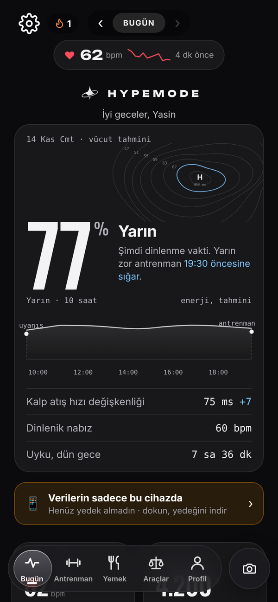 | 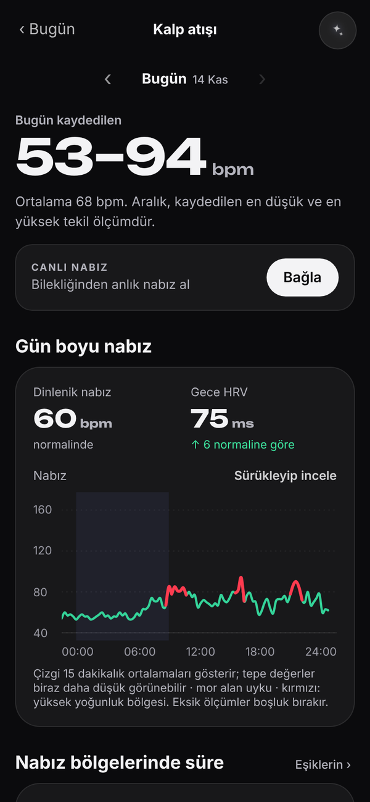 | 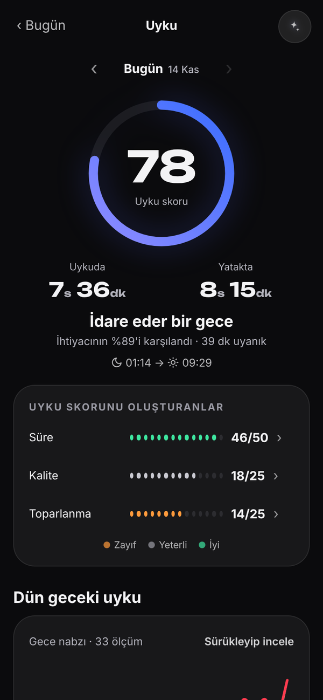 | 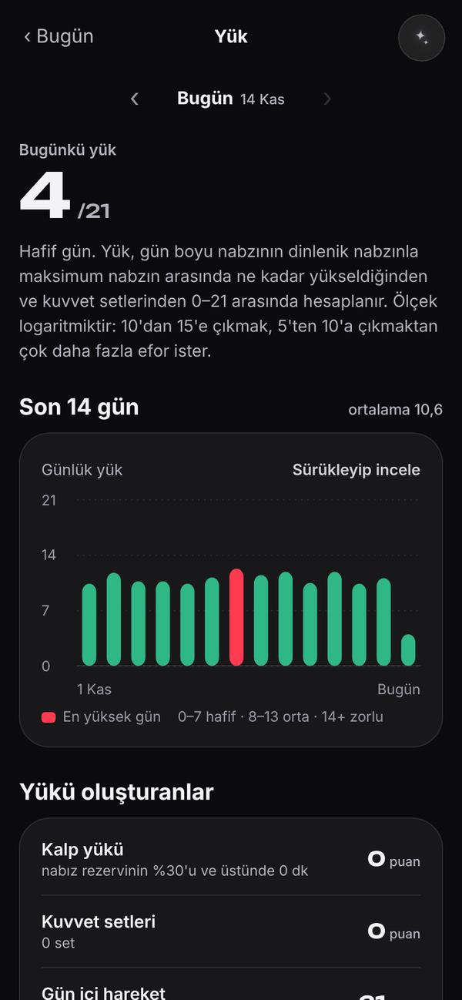 |
| Vücut tahmini, 10 saatlik enerji eğrisi, HRV haritası | Gün boyu nabız, bölgeler, canlı nabız | Uyku skoru, evreler, düzen | 0–21 günlük yük |

### Antrenman, yemek ve araçlar

| Antrenman | Yemek | Araçlar |
|:---:|:---:|:---:|
| 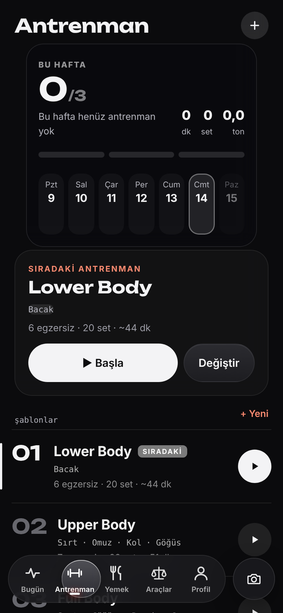 | 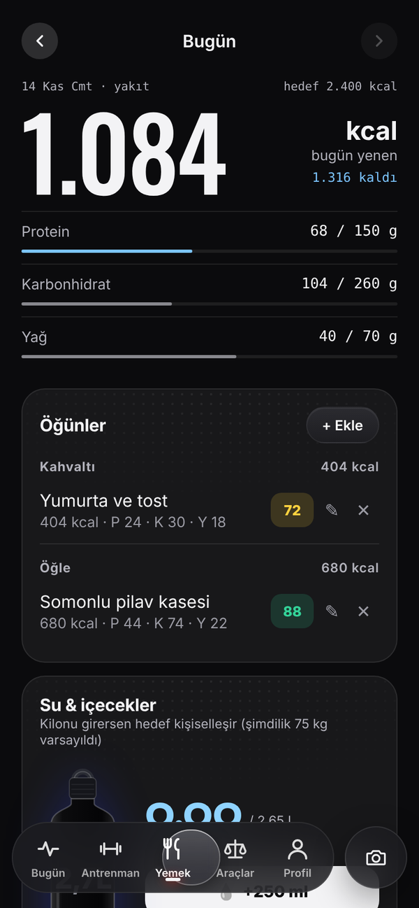 | 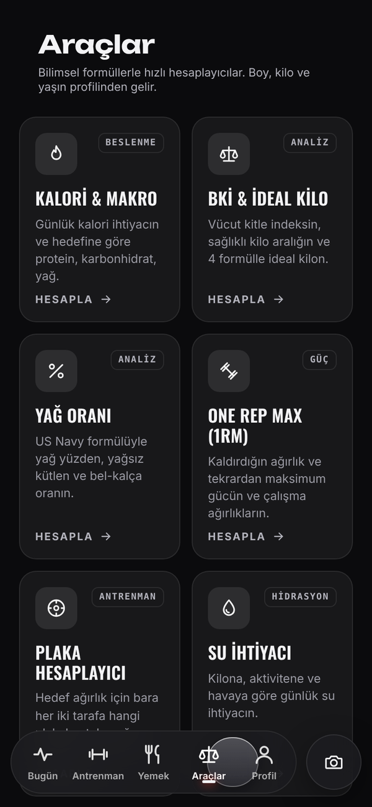 |
| Haftalık hedef, sıradaki antrenman, şablonlar | Yakıt paneli, öğünler, su ve içecekler | Kalori, BKİ, yağ oranı, 1RM, plaka, su, nabız bölgeleri |

### Profil ve ayarlar

| Profil ve arkadaşlar | Ayarlar |
|:---:|:---:|
| 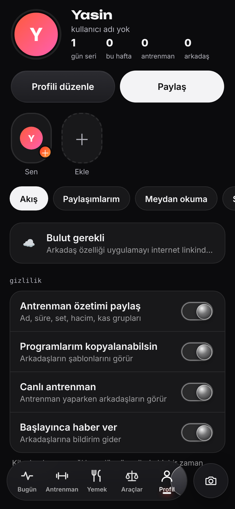 | 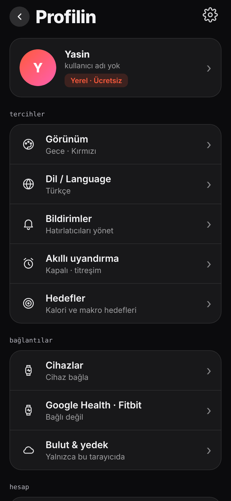 |
| Hikâyeler, akış, meydan okumalar, sıralama | Görünüm, dil, bildirimler, bağlantılar |

### Büyük ekranlar

| iPad (yatay) | Bilgisayar |
|:---:|:---:|
| 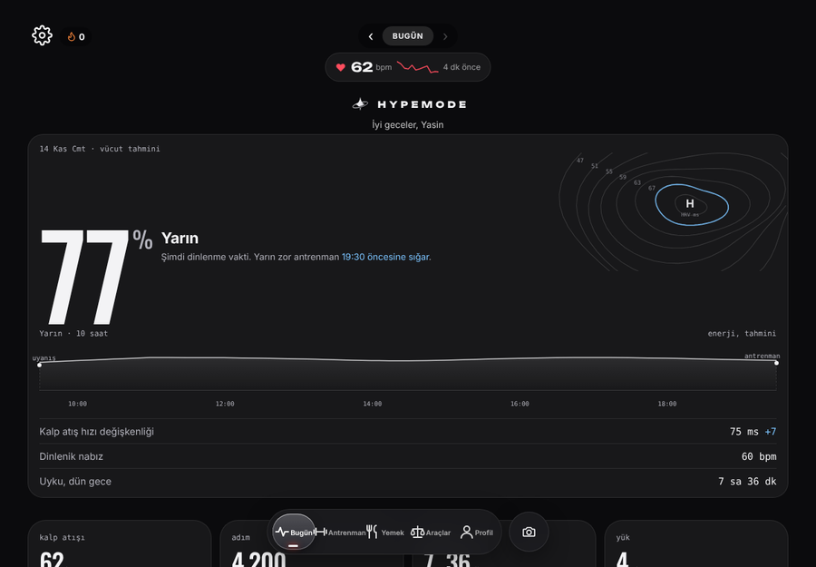 | 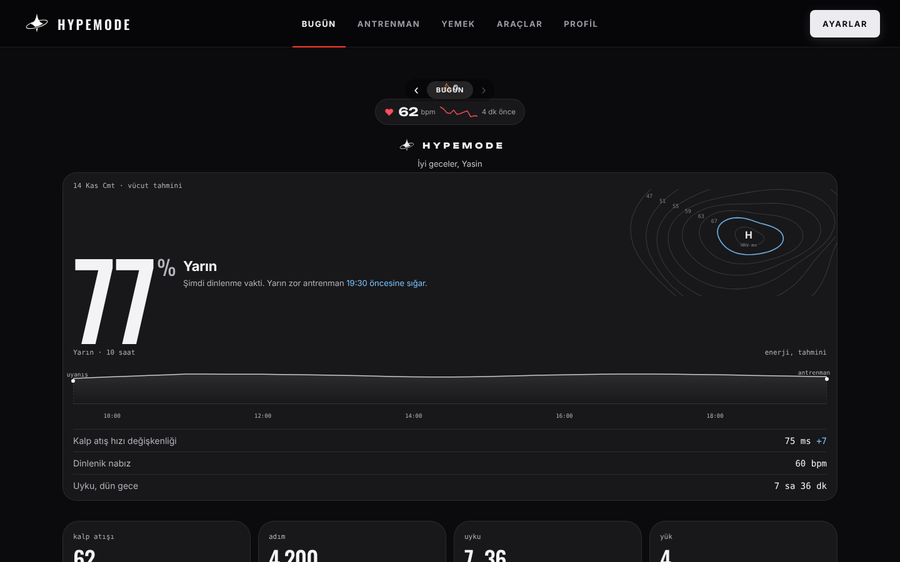 |

## Eski sürüm

İlk tasarımdan görüntüler, karşılaştırma için duruyor.

| Bugün | Kalp | Uyku | Yük | Antrenman | Yemek |
|:---:|:---:|:---:|:---:|:---:|:---:|
| 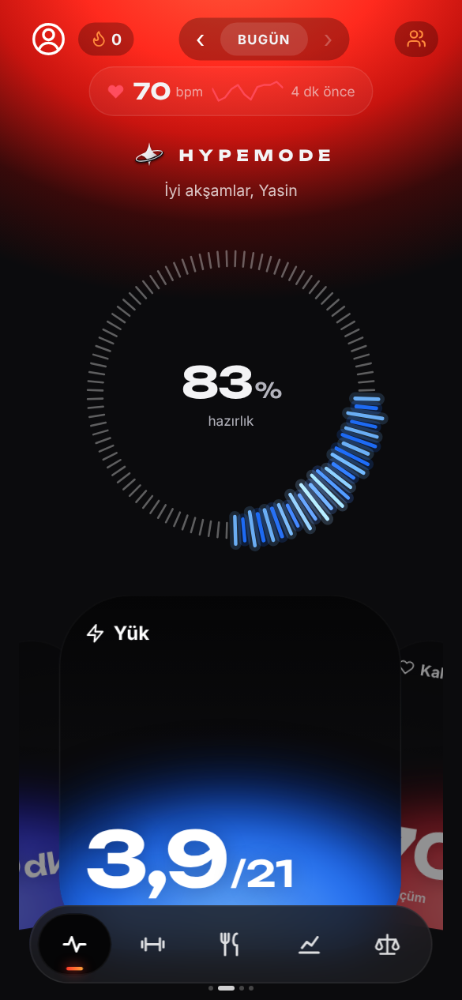 | 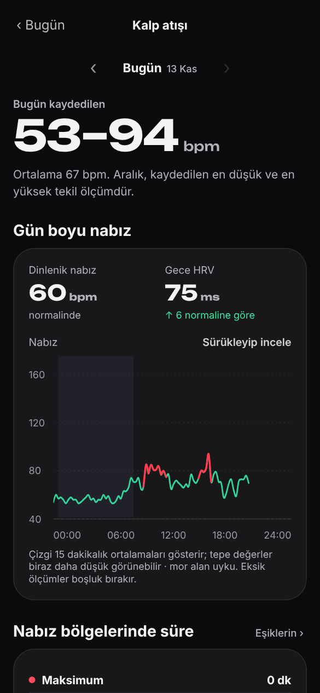 | 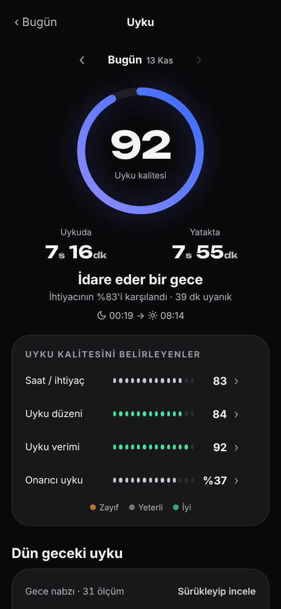 | 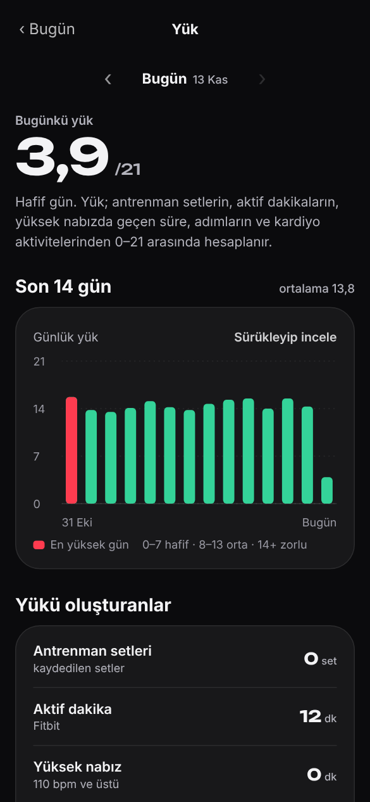 | 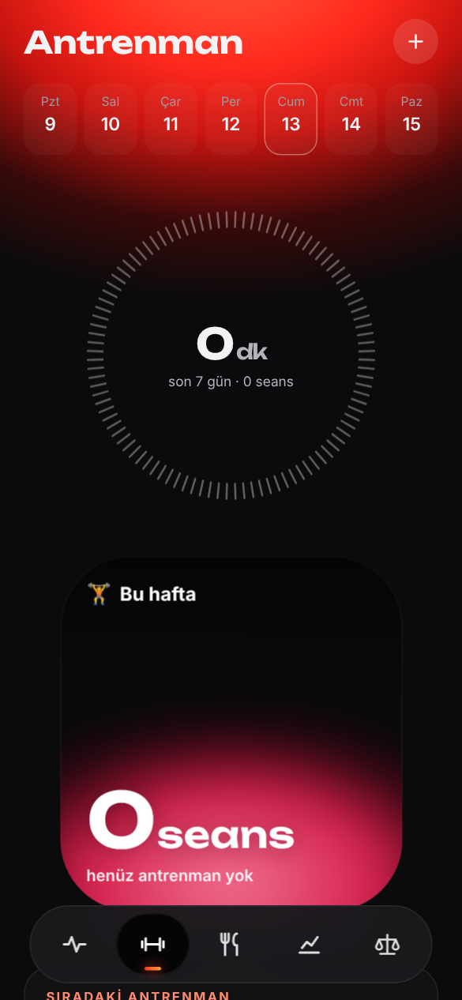 | 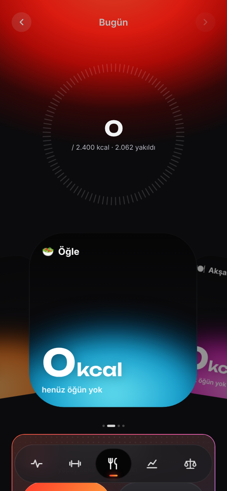 |

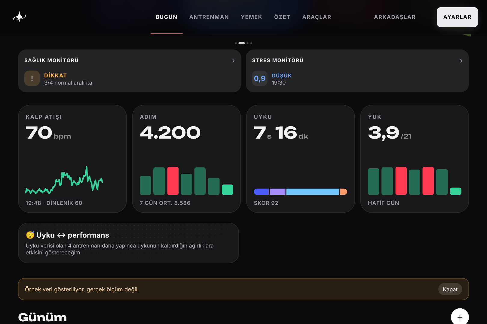
