# Screenshots

[← Back](../../README.md) · [▶ Open the app](https://yasindogruu.github.io/HypeMode/) · Taken with sample data.

| Today | Heart rate | Sleep | Strain |
|:---:|:---:|:---:|:---:|
| 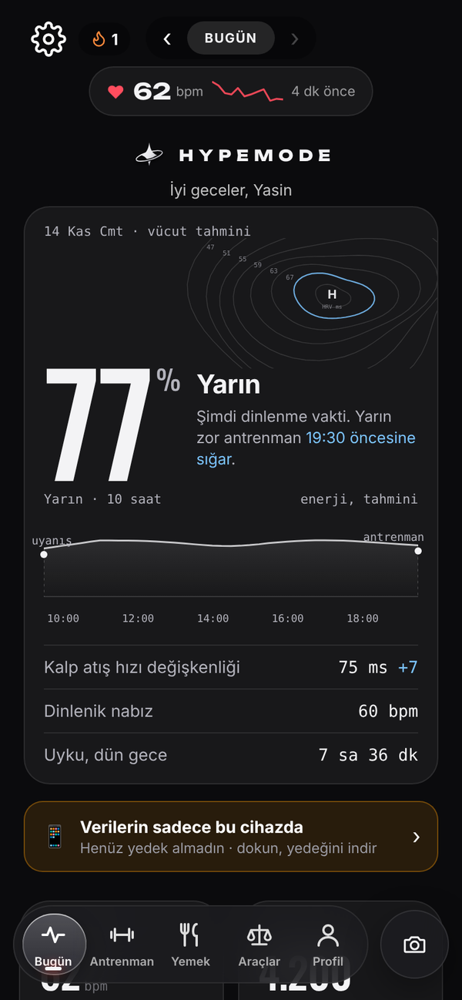 | 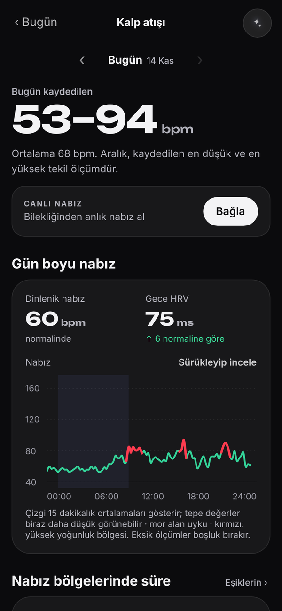 | 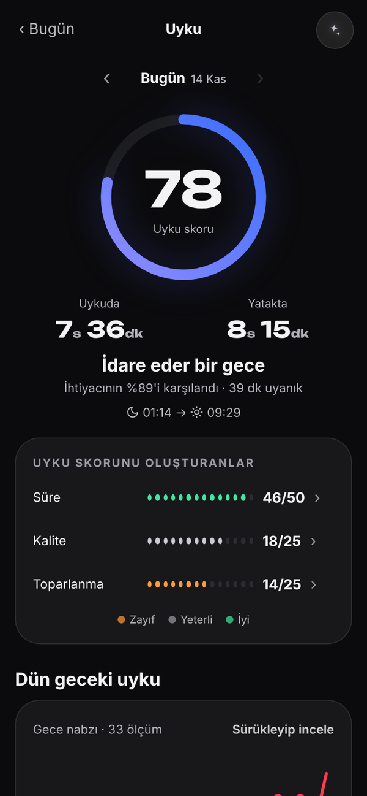 | 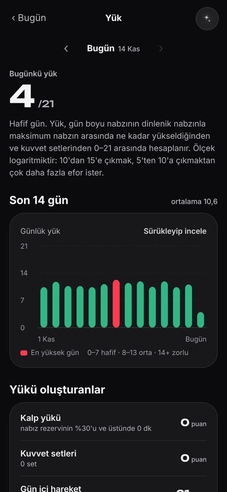 |

| Workout | Food | Tools |
|:---:|:---:|:---:|
| 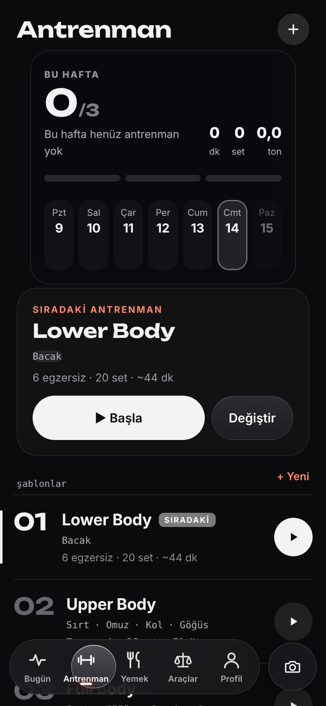 | 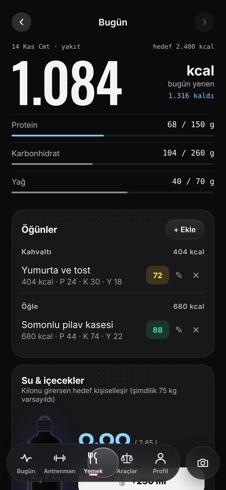 | 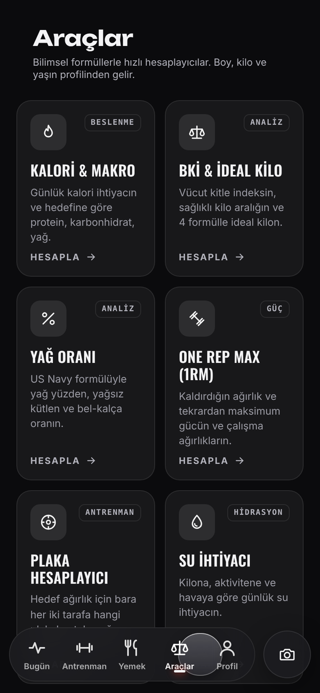 |

| Profile & friends | Settings |
|:---:|:---:|
| 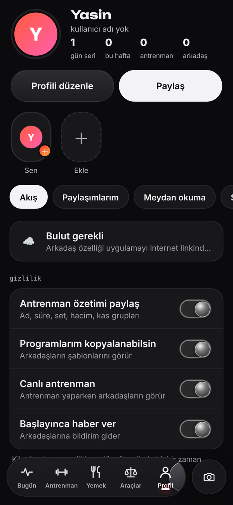 | 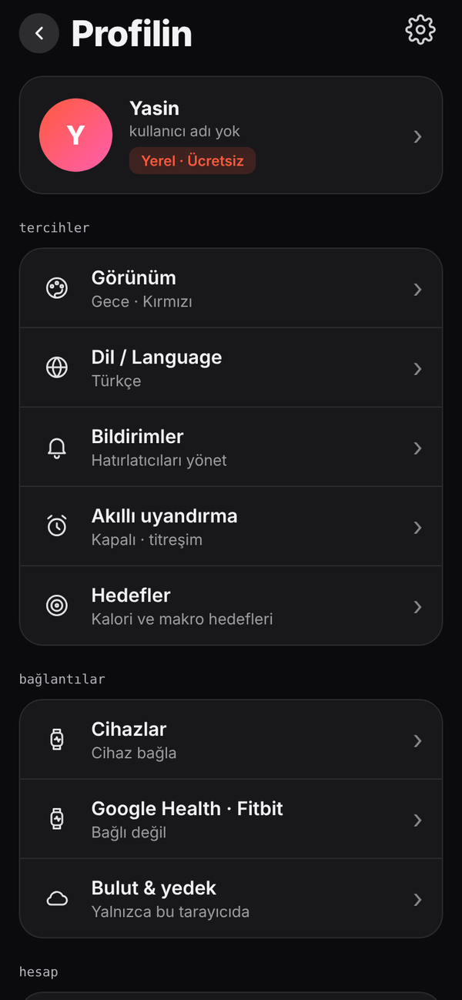 |

| iPad | Desktop |
|:---:|:---:|
| 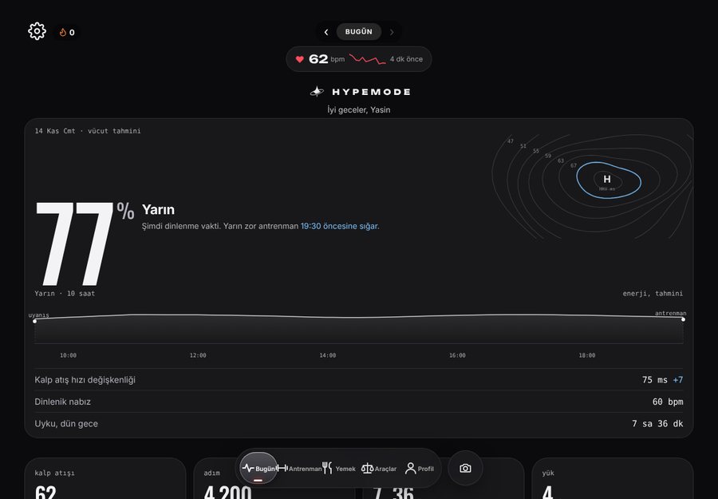 | 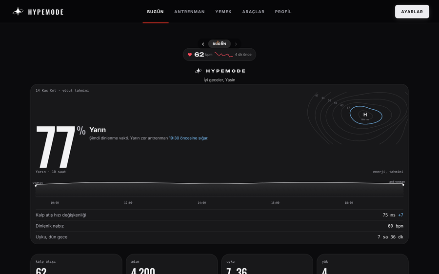 |

## Earlier design

| Today | Heart | Sleep | Strain | Workout | Food |
|:---:|:---:|:---:|:---:|:---:|:---:|
| 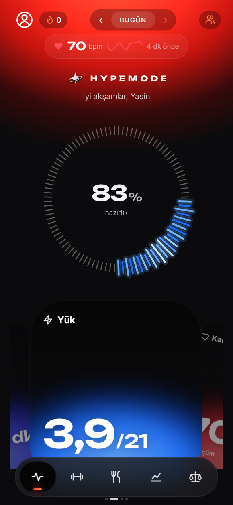 | 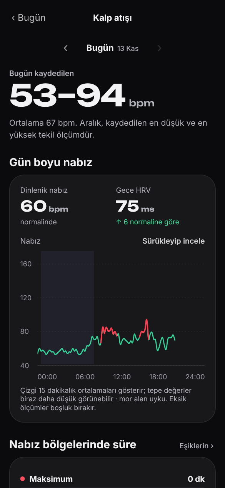 | 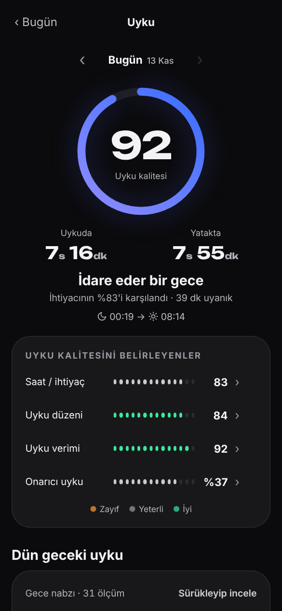 | 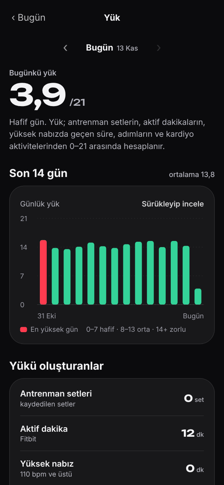 | 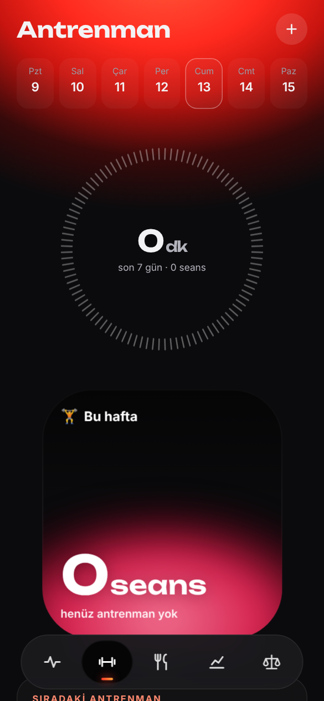 | 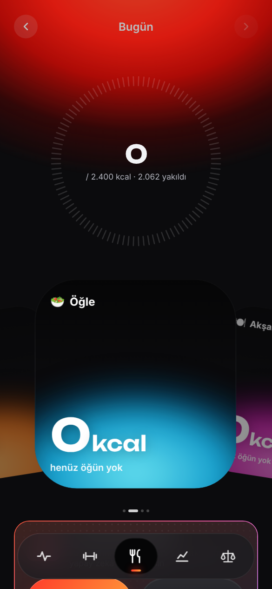 |
